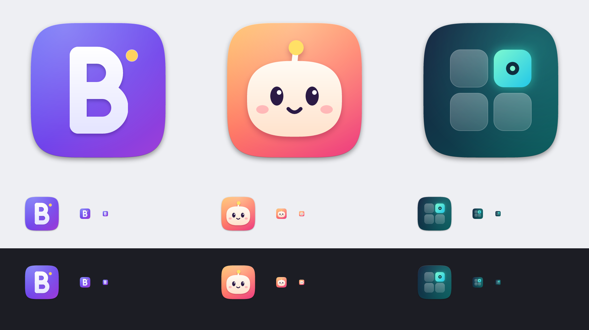

# Logo proposals

Three distinct app-icon concepts for Bixku Utilities. Each is a macOS-style
squircle (824 px body on a 1024 px canvas, ~100 px margin, soft Big Sur drop
shadow, subtle rim light) with transparent corners. The SVGs contain no text
and no external fonts or images.

`preview.png` shows each proposal at 512 / 128 / 32 / 16 px on light and dark
backgrounds. The 32 and 16 px renders are cropped to the icon body (no margin),
as macOS draws small icon sizes.

## A — "B" monogram

A geometric, rounded `B` built from three thick strokes (stem plus two bowls)
with a small amber dot, like a notification badge or a focus point.

| Role              | Hex                  |
| ----------------- | -------------------- |
| Background        | `#5B5BF5` → `#6D3FEA` → `#9B3FD9` |
| Letter            | `#FFFFFF` → `#E4E4FF` |
| Accent dot        | `#FFD25E`            |

## B — Mascot

A small, friendly blob with an antenna: playful and approachable, in line with
the name. The face keeps it readable down to 16 px.

| Role              | Hex                  |
| ----------------- | -------------------- |
| Background        | `#FFB45E` → `#FF7A63` → `#F0467E` |
| Body              | `#FFFBF4` → `#FFE2CC` |
| Antenna bulb      | `#FFE066`            |
| Eyes / mouth      | `#2B1A45`            |
| Cheeks            | `#FF7A8F` (45%)      |

## C — Modules in focus

A 2×2 grid of tiles, one of them lit with a focus dot: a suite of modules
(Dock first) with one in focus.

| Role              | Hex                  |
| ----------------- | -------------------- |
| Background        | `#17203D` → `#0F3A4A` → `#0B5558` |
| Lit tile          | `#7DF9D0` → `#22C7E8` |
| Idle tiles        | white at 30% → 16%   |
| Focus dot         | `#0F2E3F` ring, `#7DF9D0` core |

## Notes

- The SVGs are the source of truth. The PNGs (1024×1024, RGBA) were rendered
  from them with [resvg](https://github.com/RazrFalcon/resvg).
- The app icon is built from an SVG with `scripts/make-icon.sh <logo.svg>`
  (`AppIcon.iconset`, `AppIcon.icns` and an asset-catalog `AppIcon.appiconset`).
  Proposal A is the provisional icon; pass another SVG to switch. `iconutil`
  is used on macOS, a Python writer (`scripts/icon-tools.py`) elsewhere.
