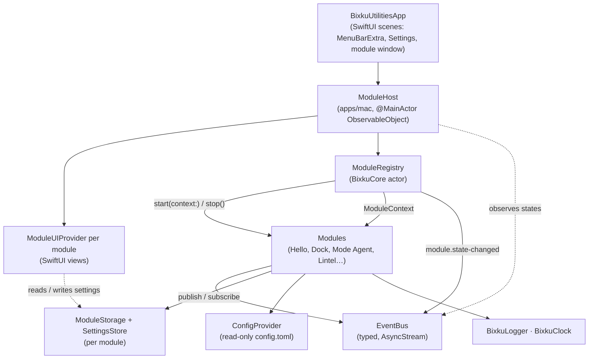
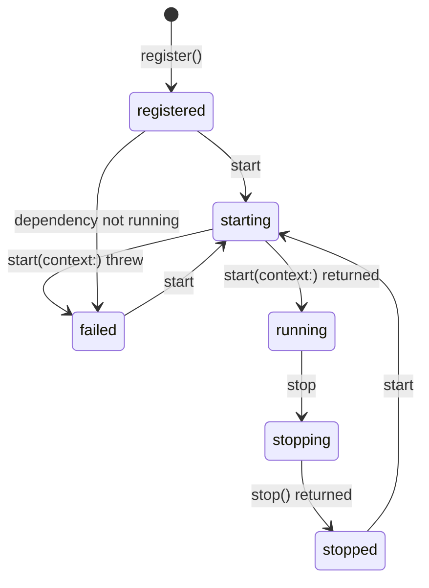

# Architecture

Bixku Utilities is a macOS menu-bar app that hosts small utilities as **modules**. The app is a thin SwiftUI shell; each utility's logic lives in a portable Swift package that builds and tests on Linux and macOS alike.

- [Overview](#overview)
- [Layers](#layers)
- [The module contract](#the-module-contract)
- [Lifecycle](#lifecycle)
- [Events](#events)
- [Persistence and configuration](#persistence-and-configuration)
- [Security and permissions](#security-and-permissions)
- [Package conventions](#package-conventions)
- [How the Dock module fits](#how-the-dock-module-fits)
- [How to add a new module (Lintel walkthrough)](#how-to-add-a-new-module-lintel-walkthrough)

## Overview

| Piece | Where | Depends on | Purpose |
| ----- | ----- | ---------- | ------- |
| **BixkuCore** | `packages/BixkuCore` | Foundation only | Module protocol, registry, event bus, storage, settings, config, logger, clock. |
| **Module packages** | `packages/Bixku<Name>` | BixkuCore (+ Foundation) | The domain logic of one utility (e.g. `BixkuDock`, `BixkuModeAgent`). |
| **App** | `apps/mac` | SwiftUI, AppKit, all packages | `ModuleHost`, menu-bar UI, settings window, OS integration (Accessibility, notifications), UI providers. |

Rules of thumb:

1. Anything that can be expressed without AppKit/SwiftUI goes into a package and gets tests that run with `swift test` on Linux.
2. Modules never talk to each other directly — they publish and consume **events** on the shared `EventBus`.
3. Modules never touch globals (fixed paths, `UserDefaults.standard`, singletons). Everything comes through the `ModuleContext`.

## Layers



The `ModuleEnvironment` (event bus, storage factory, config, log sink, clock) is created once by the host and handed to the registry, which derives one `ModuleContext` per module from it.

## The module contract

Defined in `packages/BixkuCore/Sources/BixkuCore/Module/`.

```swift
public protocol BixkuModule: AnyObject, Sendable {
    var manifest: ModuleManifest { get }
    func start(context: ModuleContext) async throws
    func stop() async
}
// Convenience: module.id, module.displayName, module.summary (read from the manifest)
```

### `ModuleManifest`

| Field | Meaning |
| ----- | ------- |
| `id: ModuleID` | Stable identifier, lowercase reverse-DNS or slug (`online.bixku.dock`). Persisted (it names the storage directory), so it never changes once shipped. |
| `displayName`, `summary` | Shown in the settings window. |
| `version: SemanticVersion` | `major.minor.patch` of the module. |
| `capabilities: Set<ModuleCapability>` | What the module does (`activity-monitoring`, `notification-processing`, `language-model`, `network`, `menu-bar`, `event-producer`, or custom strings). Informational for the host and the user. |
| `permissions: Set<ModulePermission>` | OS permissions the module needs (`accessibility`, `notifications`, `screen-recording`, `automation`, `network`). See [Security and permissions](#security-and-permissions). |
| `dependencies: [ModuleID]` | Modules that must be running before this one starts. |
| `ui: [ModuleUIDescriptor]` | Views the module contributes (see below). |
| `configKey` | Name of the module's table in the config file (`[modules.<configKey>]`). Defaults to the last segment of the id. |

### `ModuleContext`

What a module receives in `start(context:)`:

| Member | Type | Notes |
| ------ | ---- | ----- |
| `moduleID` | `ModuleID` | |
| `eventBus` | `EventBus` | Prefer `context.publish(_:)`, which stamps the module as the event source, and `context.subscribe(to:)`. |
| `storage` | `any ModuleStorage` | Private key/value JSON storage for this module only. |
| `settings` | `any SettingsStore` | User-editable settings, observable through `changes()`. Shared with the module's settings UI. |
| `config` / `moduleConfig` | `any ConfigProvider` | Read-only. `moduleConfig` is scoped to `[modules.<configKey>]`. |
| `logger` | `BixkuLogger` | Portable logger, category = module id. |
| `clock` | `any BixkuClock` | `now()` and `sleep(for:)`. Tests inject `ManualClock`. |

`BixkuLogger` and `BixkuClock` carry a prefix to avoid clashing with `os.Logger` and the standard library's `Clock`.

### UI descriptors

The core is platform-neutral, so it only describes views:

```swift
ModuleUIDescriptor(viewID: "panel", title: "Dock", systemImage: "dock.rectangle", kind: .menuBarPanel)
```

`kind` is `.menuBarPanel` (a section in the menu-bar extra), `.window` (shown in the module window, opened from the menu) or `.settings` (a section of the module's page in the settings window). In `apps/mac`, each module may register a `ModuleUIProvider` that maps `viewID` to a SwiftUI view:

```swift
@MainActor
protocol ModuleUIProvider {
    var moduleID: ModuleID { get }
    func makeView(for descriptor: ModuleUIDescriptor, context: ModuleUIContext) -> AnyView?
}
```

Menu-bar panels and windows are only shown while the module is running; settings views are always available.

## Lifecycle

`ModuleRegistry` (an actor) owns module instances and their `ModuleState`:



- **Registration** validates the id and rejects duplicates. Dependencies may be registered in any order.
- **`startupOrder()`** is a topological sort of the dependency graph; ties are broken by registration order, so the order is deterministic. It throws `missingDependency` or `dependencyCycle([a, b, …, a])`.
- **`startAll()`** validates the graph first (nothing starts if it is invalid), then starts modules in order. If a module's `start` throws, it is marked `failed` and every module depending on it is marked `failed` without being started; unrelated modules still start. Returns a `StartReport`.
- **`stopAll()`** stops active modules in reverse order (dependents before dependencies).
- **`start(id)`** starts the module's dependencies first; **`stop(id)`** stops running dependents first.
- **`unregister(id)`** stops the module and refuses if another registered module depends on it.
- Lifecycle calls are **serialized**: concurrent callers queue up instead of interleaving.
- Every transition is published as a `module.state-changed` event (`registry.stateChanges()` is a shortcut). The `ModuleHost` mirrors these into `@Published` state for SwiftUI.

Module obligations:

- `start` returns once the module is operational; long-running work runs in tasks the module owns and cancels in `stop`.
- If `start` throws, the module must have released what it acquired — `stop` is not called for failed modules.
- `stop` is idempotent, does not throw, and the module can be started again afterwards.

In the app, `AppDelegate` calls `host.bootstrap(KnownModules.all())` at launch and stops everything in `applicationShouldTerminate` (using `.terminateLater` so `stop()` can finish).

## Events

`EventBus` is an in-process, typed publish/subscribe bus built on `AsyncStream`:

```swift
// Declare a payload (usually in the producing module's package)
public struct ActivityClassified: BixkuEventPayload {
    public static let eventName: EventName = "activity.classified"
    public var category: String
}

// Publish (synchronous, never blocks)
context.publish(ActivityClassified(category: "writing"))

// Subscribe (typed); cancel the task to unsubscribe
let task = Task {
    for await event in context.subscribe(to: ActivityClassified.self) {
        print(event.payload.category, event.source, event.timestamp)
    }
}
```

- Untyped subscriptions take an `EventFilter`: `.all`, `.names([...])` or `.namespace("activity")`.
- Delivery order per publisher is preserved. There is no replay: a subscriber only sees events published after it subscribed.
- Each subscription buffers up to 256 events by default and drops the oldest ones when a consumer falls behind (configurable through `StreamBuffering`).
- Payloads are `Codable` so they can be logged, persisted or sent to a language model (`event.encodedPayload()`).
- Event names are `<namespace>.<event>`; a module uses its own namespace for private events.

Shared vocabulary declared in BixkuCore (`Events/SharedEvents.swift`), so producers and consumers don't depend on each other's packages:

| Event | Payload | Producer | Typical consumers |
| ----- | ------- | -------- | ----------------- |
| `activity.changed` | `ActivityChanged` (app bundle id, app name, window title?, detail?, category?, confidence?) | Dock (`DockEngine`) | Mode agent, Lintel |
| `notification.received` | `NotificationReceived` (app, title, subtitle?, body?) | Dock (`DockEngine`) | Mode agent |
| `mode.changed` | `ModeChanged` (previous mode, new mode, reason) | Dock (`DockEngine`) | Any module that adapts to the current mode |
| `module.state-changed` | `ModuleStateChanged` (module id, state) | `ModuleRegistry` | `ModuleHost` (UI) |

## Persistence and configuration

There are three kinds of data, each with its own API. None of them uses a hard-coded path; the host injects locations.

| Kind | API | Who writes | Backing (macOS app) |
| ---- | --- | ---------- | ------------------- |
| **Configuration** | `ConfigProvider` (read-only) | The user, by editing a TOML file | `config.toml` in the app's support directory, or the file in `$BIXKU_CONFIG` |
| **Settings** | `SettingsStore` (`ConfigValue`s, observable) | The module and its settings UI | `<data>/modules/<module-id>/settings.json` |
| **Module data** | `ModuleStorage` (JSON values by key) | The module | `<data>/modules/<module-id>/data/<key>.json` |

`<data>` is `general.data_dir` from the config if set, otherwise the app's own folder in the user's Application Support directory (resolved at runtime with `FileManager`). Tests and previews use `InMemoryStorageFactory`; `FileStorageFactory(rootDirectory:)` takes any directory.

Configuration:

- The repository only versions [`config.example.toml`](../config.example.toml). Copy it to `config.local.toml` (gitignored) and point the app at it with `BIXKU_CONFIG=/path/to/config.local.toml`, or copy it to `config.toml` in the app's support directory; neither is ever committed.
- BixkuCore ships a small TOML parser (`TOMLParser`) covering what the config needs: tables, dotted/quoted keys, strings, numbers, booleans, arrays and inline tables. Dates, multi-line strings and arrays of tables are rejected with a line-numbered error. An invalid file is ignored with a warning (the app falls back to defaults).
- `[modules.<configKey>] enabled = false` makes the host skip registering that module.
- **Secrets are never stored in the config file.** The config names an environment variable (`api_key_env`) or a Keychain item; the module resolves it at runtime.

Storage keys are restricted to `[A-Za-z0-9][A-Za-z0-9._-]*` so they are always safe file names, and module ids are validated before they are used as directory names.

## Security and permissions

- **Least privilege by declaration.** A module lists the OS permissions it needs in `manifest.permissions`. The settings window shows them with an explanation (`ModulePermission+Display.swift`). Modules never prompt the user by themselves: OS integration code lives in `apps/mac`, which requests permissions in context and feeds data to modules (e.g. as `activity.changed` events).
- **Accessibility** (AX API) is needed to read the focused app/window; **Screen Recording** may be required to read other apps' window titles on recent macOS versions; **Notifications** to post notifications. Reading other apps' notifications has no public API — the Dock design must document the approach it takes before shipping.
- **Not sandboxed (for now).** Observing other apps is incompatible with the App Sandbox. The app ships with the hardened runtime and minimal entitlements (`apps/mac/Resources/BixkuUtilities.entitlements`), distributed with Developer ID + notarization.
- **Privacy.** Activity data stays on the machine unless a module explicitly sends it to a language model. Producers must apply privacy rules (e.g. `redact_window_titles_for`) *before* publishing, so redacted data never reaches the bus.
- **Secrets.** API keys come from the environment or the Keychain, never from versioned files. `scripts/scan-secrets.sh` runs before every push and in CI.

## Package conventions

- One SwiftPM package per directory under `packages/`, named `Bixku<Name>`, with a library product of the same name, `swift-tools-version:5.9`, `platforms: [.macOS(.v13)]`.
- Sources may import **Foundation and the standard library only** (no AppKit, SwiftUI, Combine, `os`). Use `BixkuLogger`, `BixkuClock` and the injected stores instead of system singletons.
- Code is `Sendable`-clean (BixkuCore builds cleanly in the Swift 6 language mode); modules are usually actors.
- Tests use XCTest and must pass with `swift test` on Linux (`scripts/test-packages.sh` runs every package; CI runs it on Linux and macOS).
- Packages depend on each other by relative path: `.package(path: "../BixkuCore")`. The app depends on them with `.package(path: "../../packages/<Name>")`.
- Module ids: `online.bixku.<slug>`. Event namespaces: the module slug.

## How the Dock module fits

The Dock engine is implemented in `packages/BixkuDock` (see **[dock.md](dock.md)** for the full design: modes, classification, transitions, triage, events and configuration). The mode agent and the macOS integration are separate work streams; this table is the contract between them.

| | `BixkuDock` (`online.bixku.dock`) — implemented | `BixkuModeAgent` (`online.bixku.mode-agent`) — planned |
| - | --- | --- |
| Role | Mode engine: modes (writing, building, …) as validated, versioned JSON; the current mode (automatic rules + manual override); activity classification (rules + optional LLM); notification triage, held queue and digests. | Agent that tunes mode behavior and creates new modes, using a language model. |
| Depends on | BixkuCore | BixkuCore, `BixkuDock` (types), `online.bixku.dock` (manifest dependency) |
| Capabilities | `activity-monitoring`, `notification-processing`, `language-model`, `menu-bar`, `event-producer` | `language-model`, `network` |
| Permissions | `accessibility`, `screen-recording`, `notifications` | `network` |
| Publishes | `activity.changed`, `notification.received`, `mode.changed`, `notification.triaged`, `dock.activity-classified`, `dock.digest-ready`, `dock.command-result` | `mode-agent.*` *(names planned)*, `dock.command` |
| Consumes | `dock.command` (`activateMode`, `saveMode`, `deleteMode`) | `activity.changed`, `notification.*`, `mode.changed`, `dock.*` |
| Storage | Mode documents in module storage (`mode.<id>` keys) or `[modules.dock] modes_dir` | Agent memory / history |
| Config | `[modules.dock]` (default mode, privacy, smoothing, transitions, LLM limits), `[llm] request_timeout_seconds` | `[llm]` |
| UI (apps/mac) | Menu-bar panel (`panel`: current mode, switcher, held, digest), settings (`modes`) — to be built | Settings (provider, review of agent changes) |

Injection points (all protocols in `BixkuDock`): the app provides `ActivitySource` / `NotificationSource` (NSWorkspace, Accessibility, idle time); the LLM provider implements `LLMClassifying`, `LLMNotificationTriaging` and `DigestSummarizing` and is passed to `DockModule` (at init or with `setLLM`). Once the app's sources exist, `DockModule` replaces the `Hello` example module in `KnownModules`.

## How to add a new module (Lintel walkthrough)

Lintel is the next planned module. Adding it touches four places.

### 1. Create the package

```
packages/BixkuLintel/
  Package.swift
  Sources/BixkuLintel/LintelModule.swift
  Tests/BixkuLintelTests/LintelModuleTests.swift
```

```swift
// swift-tools-version:5.9
import PackageDescription

let package = Package(
    name: "BixkuLintel",
    platforms: [.macOS(.v13)],
    products: [.library(name: "BixkuLintel", targets: ["BixkuLintel"])],
    dependencies: [.package(path: "../BixkuCore")],
    targets: [
        .target(name: "BixkuLintel", dependencies: [.product(name: "BixkuCore", package: "BixkuCore")]),
        .testTarget(name: "BixkuLintelTests", dependencies: ["BixkuLintel"]),
    ]
)
```

### 2. Implement `BixkuModule`

```swift
import BixkuCore
import Foundation

public actor LintelModule: BixkuModule {
    public static let id: ModuleID = "online.bixku.lintel"

    private static let manifestValue = ModuleManifest(
        id: id,
        displayName: "Lintel",
        summary: "…",
        version: "0.1.0",
        capabilities: [.menuBar],
        ui: [
            ModuleUIDescriptor(viewID: "panel", title: "Lintel", systemImage: "square.split.2x1", kind: .menuBarPanel),
            ModuleUIDescriptor(viewID: "settings", title: "Lintel", systemImage: "square.split.2x1", kind: .settings),
        ]
    )

    public nonisolated var manifest: ModuleManifest { Self.manifestValue }

    private var listener: Task<Void, Never>?

    public init() {}

    public func start(context: ModuleContext) async throws {
        let activity = context.subscribe(to: ActivityChanged.self)
        listener = Task { [weak self] in
            for await event in activity {
                await self?.handle(event.payload)
            }
        }
        context.logger.info("Lintel started")
    }

    public func stop() async {
        listener?.cancel()
        listener = nil
    }

    private func handle(_ activity: ActivityChanged) { /* … */ }
}
```

Use `context.storage` / `context.settings` for persistence and `context.moduleConfig` for `[modules.lintel]`. Never read files or defaults directly.

### 3. Test it on Linux

```swift
import BixkuCore
import XCTest
@testable import BixkuLintel

final class LintelModuleTests: XCTestCase {
    func testStartsAndReactsToActivity() async throws {
        let bus = EventBus()
        let registry = ModuleRegistry(environment: ModuleEnvironment(eventBus: bus, logSink: DiscardingLogSink()))
        try await registry.register(LintelModule())
        let report = try await registry.startAll()
        XCTAssertTrue(report.isSuccess)
        bus.publish(ActivityChanged(appBundleID: "com.example.editor", appName: "Editor"))
        // assert on published events / storage …
        await registry.stopAll()
    }
}
```

Run `scripts/test-packages.sh` (it picks up every package automatically). Use `InMemoryStorageFactory` (the default) and `ManualClock` for deterministic tests.

### 4. Wire it into the app

1. `apps/mac/Package.swift`: add `.package(path: "../../packages/BixkuLintel")` and the `BixkuLintel` product to the executable target.
2. `apps/mac/Sources/BixkuUtilities/Modules/Lintel/LintelModuleUI.swift`: a `@MainActor struct LintelModuleUI: ModuleUIProvider` that returns a SwiftUI view for `"panel"` and `"settings"` (see `HelloModuleUI.swift`).
3. `apps/mac/Sources/BixkuUtilities/Host/KnownModules.swift`: add `ModuleRegistration(module: lintel, ui: LintelModuleUI(module: lintel))`.
4. `config.example.toml`: document the `[modules.lintel]` keys (example values only).
5. `README.md`: update the module table.

The host takes care of the rest: dependency ordering, starting/stopping, the menu-bar panel, the settings page with state, permissions and the module's settings view.
