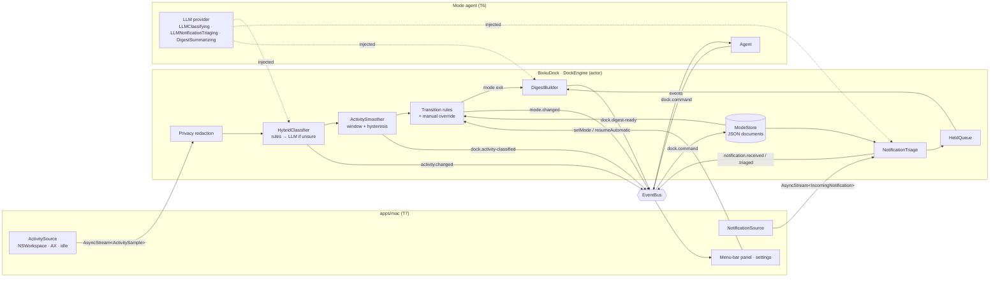

# Dock

The Dock is the first Bixku module: an AI-native take on the macOS dock built around **focus modes** (writing, building, reading, meeting, break, free…). It watches what you are doing, classifies it in real time, switches modes automatically, and decides which notifications may interrupt you. A separate agent (the mode agent) can tune modes and create new ones.

This document describes the engine in `packages/BixkuDock` and how the other pieces plug into it. For the module system itself see [architecture.md](architecture.md).

- [Pieces and responsibilities](#pieces-and-responsibilities)
- [Data flow](#data-flow)
- [Modes](#modes)
- [Activity classification](#activity-classification)
- [Automatic transitions and manual override](#automatic-transitions-and-manual-override)
- [Notification triage and digests](#notification-triage-and-digests)
- [Events](#events)
- [Configuration](#configuration)
- [Plugging in the mode agent and the macOS app](#plugging-in-the-mode-agent-and-the-macos-app)
- [Testing](#testing)
- [Limitations and open questions](#limitations-and-open-questions)

## Pieces and responsibilities

`BixkuDock` is a portable SwiftPM package (Foundation + BixkuCore only). It builds and tests on Linux; everything platform-specific is injected through protocols.

| Area | Types | Folder |
| ---- | ----- | ------ |
| Mode model | `ModeDefinition`, `ModeID`, `ModeRule`, `NotificationPolicy`, `AttentionRules`, `DockLayout`, `Mode`, `ModeCatalog`, `DefaultModes` | `Modes/` |
| Mode persistence | `ModeStore`, `JSONModeStore`, `ModeDocumentBackend` (`FileModeBackend`, `StorageModeBackend`, `InMemoryModeBackend`), `ModeValidator`, `ModeMigrator` | `Modes/` |
| Activity | `ActivitySample`, `ActivityVerdict`, `ActivityClassifier`, `RuleBasedClassifier`, `ActivitySmoother`, `LLMClassifying`, `HybridClassifier`, `MockLLM` | `Activity/` |
| Notifications | `IncomingNotification`, `NotificationCategorizer`, `NotificationTriage`, `LLMNotificationTriaging`, `HeldQueue`, `DigestBuilder`, `DigestSummarizing` | `Notifications/` |
| Engine | `DockEngine`, `DockState`, `DockConfiguration`, `DockCommand`, Dock events | `Engine/` |
| Inputs | `ActivitySource`, `NotificationSource`, `ManualSource`, `ScriptedSource` | `Inputs/` |
| Module | `DockModule` (`online.bixku.dock`) | `Module/` |

## Data flow



## Modes

A mode is a JSON document (`ModeDefinition`, schema version 1):

```json
{
  "schemaVersion": 1,
  "id": "building",
  "name": "Building",
  "symbol": "hammer",
  "description": "Programming and shipping. IDEs, terminals and code hosting are on task; build and CI results come through, chat is summarized and everything else waits.",
  "dock": { "prioritized": ["com.apple.dt.Xcode", "com.apple.Terminal"], "hidden": ["com.apple.Music"] },
  "attention": {
    "focus": { "categories": ["code"], "apps": ["com.jetbrains.*"], "urlHosts": ["github.com"] },
    "distractions": { "categories": ["media"], "urlHosts": ["youtube.com"] }
  },
  "notifications": {
    "default": "hold",
    "rules": [
      { "match": { "categories": ["build"] }, "action": "allow", "note": "Build and CI results are part of the work" },
      { "match": { "categories": ["chat"] }, "action": "summarize", "whileActivity": { "categories": ["code"] } }
    ],
    "alwaysAllow": { "categories": ["calendar"] },
    "urgent": { "keywords": ["urgent", "outage"], "categories": [], "honorTimeSensitive": true },
    "allowFromFocusedApp": true
  },
  "transitions": [
    { "trigger": "activity", "match": { "categories": ["code"] }, "forSeconds": 300, "from": ["free"], "priority": 0 }
  ]
}
```

| Field | Meaning |
| ----- | ------- |
| `id` | Lowercase slug (`[a-z0-9]` words joined by `-`, ≤ 64). Names the document. |
| `name`, `symbol` | Display name and SF Symbol. |
| `description` | Natural-language intent of the mode. Shown to the user and given to the LLM/agent as the mode's "prompt". Required. |
| `dock.prioritized` / `dock.hidden` | Exact bundle ids shown first / bundle id patterns hidden (`DockLayout.arrange`). |
| `attention.focus` / `attention.distractions` | `ActivityMatcher`s: what is on task vs. a distraction in this mode. A specific match (app, URL host, title keyword) beats a category match; ties go to focus. |
| `notifications` | `NotificationPolicy` — see [triage](#notification-triage-and-digests). |
| `transitions` | `ModeRule`s that switch **into** this mode automatically. |

Matchers: `ActivityMatcher { apps, categories, titleKeywords, urlHosts }` and `NotificationMatcher { apps, categories, keywords }`. Criteria are alternatives (any match); an empty matcher matches nothing. App patterns are exact bundle ids, a trailing wildcard (`com.jetbrains.*`) or `*`; URL hosts match subdomains (`github.com` matches `gist.github.com`).

Categories are closed enums: activities are `code | writing | browsing | communication | media | meeting | other`; notifications are `direct-message | mention | chat | email | calendar | build | system | social | promotion | other`.

### Factory modes

Six modes ship as JSON in `DefaultModes.json` (same format as user documents, so they double as examples):

| Mode | Notifications by default | Enters automatically when |
| ---- | ------------------------ | ------------------------- |
| `writing` | hold; chat summarized; feeds/promos silenced; calendar always | writing apps/sites for 5 min |
| `building` | hold; build/CI allowed; chat summarized; feeds/promos silenced | code for 5 min |
| `reading` | summarize; DMs held | a reader app or PDF/EPUB for 10 min |
| `meeting` | hold; chat/email summarized; no "focused app" shortcut | meeting app/site for 1 min (priority 10) |
| `break` | allow | idle for 10 min (priority 5) |
| `free` *(default)* | allow; promotions summarized | browsing/chat/media/other for 15 min, only from `break` |

### Storage, overrides and validation

`ModeStore` resolves a `ModeCatalog`: factory modes overlaid with the user's documents. A user document with a factory id **overrides** that mode (`provenance = .userOverride`); deleting it restores the factory mode; factory modes themselves cannot be deleted. `JSONModeStore` works over any `ModeDocumentBackend`:

- `FileModeBackend(directory:)` — `<directory>/<id>.json`, used when `[modules.dock] modes_dir` is set. The directory is always injected; nothing in the package knows a path.
- `StorageModeBackend(storage:)` — the module's `ModuleStorage` under `mode.<id>` keys (the default).
- `InMemoryModeBackend` — tests and previews.

Loading never fails because of a bad user document: each document is migrated, decoded and validated; failures are skipped (the factory mode stays in effect) and reported in `ModeCatalog.issues` / `DockState.modeIssues` with messages such as `building: transitions[0].forSeconds: must be greater than 0`. `save` validates first and throws `ModeStoreError.invalid(ModeValidationError)` listing every issue with a JSON path.

`ModeValidator` checks ids, required text, app patterns, URL hosts, contradictions (an app both prioritized and hidden, or both focus and distraction), empty notification rules, transition durations (0 < s ≤ 1 day), trigger/match consistency, and `from` references (unknown modes, self-transitions).

### Schema migrations

`ModeMigrator` upgrades the raw JSON object before decoding. Documents without `schemaVersion` are treated as version 1; documents from a newer build are rejected (`unsupportedSchemaVersion`) instead of guessed at. To change the schema: bump `ModeDefinition.currentSchemaVersion`, append a `ModeMigration(fromVersion: n)` to `ModeMigrator.builtIn`, and add a test with a document in the old format. Saves always write the current version.

## Activity classification

An `ActivitySample` is what the source sees: bundle id, app name, window title, URL, document, timestamp and idle seconds. Classification has two layers:

1. **Per-sample verdict** (`ActivityClassifier`) → `ActivityVerdict { category, confidence, suggestedMode?, rationale, source }`.
   - `RuleBasedClassifier`: the highest-confidence matching `CategoryRule` of a `CategoryRuleSet` (codable; `.standard` covers common macOS apps, sites and window titles). Browsers alone are `browsing` at 0.5, so sites/titles refine them; unknown apps are `other` at 0.2.
   - `HybridClassifier` (actor): rules first; only when their confidence is below `LLMUsagePolicy.confidenceThreshold` (0.6) it consults the `LLMClassifying` provider, with a TTL cache keyed by app/title/site/document, request sharing for identical in-flight inputs, a sliding-window rate limit, and a timeout on the injected clock that holds even if the provider ignores cancellation. Any failure falls back to the rules' verdict (`source = .fallback`, reason appended).
2. **Smoothing** (`ActivitySmoother`): verdicts weighted by how long they stayed in front × confidence, over a sliding window (90 s); the current category only changes when another one leads by `switchMargin` (0.2). Idle time does not count. Glancing at chat while coding doesn't flip the category.

The engine classifies once per change of focus (same app/title/URL/document → cached verdict), so periodic samples are cheap. Apps listed in `privacy.redact_window_titles_for` are redacted on arrival: their titles, URLs and documents never reach classifiers, the LLM, the bus or the state.

`suggestedMode` from the LLM is advisory: it is surfaced in `DockState.suggestedMode` for the UI, never applied on its own.

## Automatic transitions and manual override

Every mode lists `transitions` that switch **into** it:

- `activity` trigger: the matcher has held for `forSeconds`, measured as the trailing run of matching foreground time. Non-matching stretches up to `transition_grace_seconds` (30 s) are tolerated (not counted, but they do not end the run). Idle samples don't match.
- `idle` trigger: the latest sample reports at least `forSeconds` of inactivity (sources sample periodically, so idle time stays current).
- `from`: only switch from these modes. `priority`: higher wins; then the longer run; then catalog order.
- After any change, automatic transitions wait `minimum_mode_dwell_seconds` (60 s) to avoid flip-flopping.

Rules are evaluated on every sample and on clock ticks (`tick_interval_seconds`, 10 s), so time-based rules fire even when nothing new arrives.

Precedence:

1. **The user's manual choice always wins.** `setMode(_:until:)` pins a mode (optionally until a deadline); rules are suspended until it expires or `resumeAutomatic()` is called, after which rules may fire immediately.
2. **Agent activation** (`activateMode(_:reason:)`, or the `dock.command` event) switches without pinning and is refused (`manualModeActive`) while the user's choice is in effect.
3. **Transition rules.**

If the active mode disappears from the catalog (deleted by the user or the agent), the engine falls back to the default mode.

## Notification triage and digests

`IncomingNotification` carries app, title, subtitle, body, optional category, the OS time-sensitive flag, thread id and timestamp. `NotificationCategorizer` infers a missing category (keywords first — a CI bot in a chat app is `build` — then well-known apps).

`NotificationTriage` decides `allow | hold | summarize | silence` with a reason. First applicable wins:

1. the mode's `alwaysAllow` exceptions → allow;
2. urgency (`honorTimeSensitive`, urgent categories, urgent keywords) → allow, `isUrgent`;
3. `allowFromFocusedApp` and the notification comes from the frontmost app → allow;
4. the mode's `rules` in order (`whileActivity` restricts a rule to a current activity);
5. the mode's `default`. Only here is the optional `LLMNotificationTriaging` consulted (same cache, rate limit and timeout as activities); on failure the default stands.

`hold` and `summarize` go to a bounded `HeldQueue` (500; overflow drops the oldest and counts it). When the mode changes, `DigestBuilder` turns the queue into a `NotificationDigest`: `hold` items individually, `summarize` items grouped per app with per-category counts, recent headlines and thread counts, plus a deterministic summary (*"While in Writing (45m): 6 notifications. 2 held: Messages, Mail. Summarized: Slack ×3 (2 chat, 1 mention), News ×1."*). An optional `DigestSummarizing` provider can replace the text (bounded by the LLM timeout). `releaseHeld()` empties the queue without ending the mode ("show now").

## Events

Published with source `online.bixku.dock`:

| Event | Payload | When |
| ----- | ------- | ---- |
| `mode.changed` | `ModeChanged` (core) — previous, new, reason (`initial`, `manual`, `automatic: code for 5m`, `automatic: agent: …`) | On start and every change |
| `activity.changed` | `ActivityChanged` (core) — app, title, detail (site or document), `category`, `confidence` | Foreground app/window/document changed |
| `dock.activity-classified` | `ActivityClassified` — `CurrentActivity` (sample, verdict, smoothed category, attention, idle) and mode | Smoothed category, attention or idleness changed |
| `notification.received` | `NotificationReceived` (core) | Every notification |
| `notification.triaged` | `NotificationTriaged` — id, app, title, category, action, reason, urgency, source, mode | Every notification, after triage |
| `dock.digest-ready` | `DigestReady` — `NotificationDigest` | A mode with held notifications ended |
| `dock.command-result` | `DockCommandResult` — command id, success, message | After each `dock.command` |

Consumed: `dock.command` (`DockCommand`: `activateMode`, `saveMode`, `deleteMode`).

`DockEngine.state` is a thread-safe snapshot (`DockState`: mode selection, active definition, current activity, held queue, last digest, suggestion, mode issues) and `states()` streams changes for the UI.

## Configuration

`[modules.dock]` in the config file (all optional; see `DockConfiguration.init(config:llmConfig:)`):

| Key | Default | Meaning |
| --- | ------- | ------- |
| `default_mode` | `free` | Mode at startup (unknown ids fall back to `free`). |
| `modes_dir` | — | Store user modes as JSON files in this directory (`~` is expanded) instead of module storage. |
| `classify_notifications` | `true` | Use the notification LLM hook when one is provided. |
| `privacy.redact_window_titles_for` | `[]` | Bundle id patterns whose titles/URLs/documents are dropped on arrival. |
| `smoothing_window_seconds` | 90 | Sliding window of the smoother. |
| `idle_threshold_seconds` | 120 | Idle time after which a sample counts as idle. |
| `transition_grace_seconds` | 30 | Tolerated interruption inside a transition run. |
| `minimum_mode_dwell_seconds` | 60 | Minimum time between automatic changes. |
| `tick_interval_seconds` | 10 | Re-evaluation period without new samples (0 disables). |
| `llm_confidence_threshold` | 0.6 | Below this, the LLM is consulted. |
| `llm_max_requests_per_minute` | 12 | LLM rate limit (0 disables LLM calls). |
| `[llm] request_timeout_seconds` | 8 | LLM timeout. |

`activity_sample_interval` is read by the activity source in the app, not by the engine.

## Plugging in the mode agent and the macOS app

### Mode agent and LLM provider (T6)

- Implement `LLMClassifying` (activity), `LLMNotificationTriaging` (notifications) and optionally `DigestSummarizing` on top of the shared LLM client. Contracts: fast, cancellable, throw on failure; the Dock enforces timeout, cache and rate limit, and only sends privacy-redacted samples. Inputs include the mode definitions (their `description` is the natural-language intent) and recent classified activity.
- Hand them to the Dock with `DockModule(llm:notificationLLM:summarizer:)` or, at runtime, `DockModule.setLLM(activity:notifications:)`.
- To tune or create modes, publish `DockCommand(.saveMode(definition))` / `.deleteMode(id)` and to switch, `.activateMode(id, reason:)`; read the outcome in `dock.command-result` (validation issues are in `message`). Build definitions with the types in `Modes/` and pre-check with `ModeValidator`. The agent never overrides a manual choice.
- The mode agent itself reaches the engine through `DockEngineAccess` (in `BixkuModeAgent`), which uses `activateMode(_:reason:)`, `recentActivity(limit:)`, `releaseHeld(_:)` (one notification) and `updateCatalog(_:)`; see [mode-agent.md](mode-agent.md#wiring-in-the-app).
- Observe `activity.changed`, `dock.activity-classified`, `notification.triaged`, `mode.changed` and `dock.digest-ready` to learn the user's patterns.

### macOS app (T7)

- Implement `ActivitySource` (frontmost app via `NSWorkspace`, focused window title and browser URL via Accessibility, idle time via `CGEventSource`) and `NotificationSource`; emit on every change and periodically (`activity_sample_interval`). `start()` may throw for a missing permission; the module logs it and keeps running.
- Register `DockModule(activitySource:notificationSource:…)` in `KnownModules` (replacing `Hello`) and add a `ModuleUIProvider` for the `panel` (current mode, switcher via `setMode` / `resumeAutomatic`, suggestion, held count, last digest) and `modes` (catalog, issues, editing through `saveMode`) views. Read `engine.state` / `engine.states()`.
- Act on `notification.triaged`: `allow` → leave it; `hold` / `summarize` / `silence` → remove or hide it; present `dock.digest-ready` (e.g. a summary notification).
- `DockLayout.arrange(_:)` orders the dock items for the active mode.

## Testing

`swift test` in `packages/BixkuDock` (Linux and macOS; run every package with `scripts/test-packages.sh`). Time is injected (`ManualClock`) and inputs are scripted (`ManualSource`, `ScriptedSource`, `MockLLM`), so tests are deterministic. They cover serialization, validation and migration of modes, the stores, the rule classifier, smoothing and hysteresis, the hybrid classifier (threshold, cache, sharing, rate limit, timeouts, errors), categorization, triage, digests, automatic transitions (grace, dwell, idle, priority, `from`), manual override and agent activation, catalog reloads, published events, commands, configuration parsing and the module lifecycle inside a `ModuleRegistry`.

## Limitations and open questions

- **Reading other apps' notifications** has no public macOS API. The `NotificationSource` contract is defined, but the app still has to choose and document an approach (e.g. observing the Notification Center UI through Accessibility) before shipping.
- **Hiding/re-posting notifications** is the host's job and depends on that approach; the engine only decides.
- The **activity categories are a closed set**; agent-created categories would need a schema change (migration).
- The LLM `suggestedMode` is advisory only; acting on it automatically is a policy decision left to the agent.
