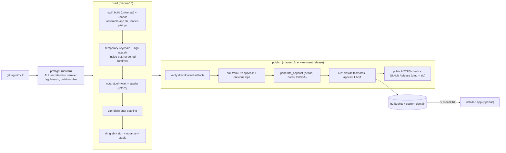

# Releasing Bixku Utilities (macOS)

GitHub Actions builds **Bixku Utilities.app**, signs it with a **Developer ID Application** certificate, **notarizes** and **staples** it, and publishes:

| Artifact | Where | What |
|---|---|---|
| `BixkuUtilities-<version>.dmg` | GitHub Release | Drag-to-Applications disk image (background with arrow, app icon + Applications folder link). Signed with Developer ID, notarized, stapled. |
| `BixkuUtilities-<version>.zip` | GitHub Release **and** the Sparkle feed in Cloudflare R2 | The app (`ditto -c -k --sequesterRsrc --keepParent`), signed, notarized, stapled. Sparkle downloads this one. |
| `appcast.xml` | Cloudflare R2 | Sparkle feed generated by `generate_appcast`, EdDSA-signed (feed, zips and deltas). |
| `*.sha256` | GitHub Release | Checksums of the DMG and the zip. |

Updates are served from `https://updates.novarix.online/bixku-utilities/`:

```
https://updates.novarix.online/bixku-utilities/appcast.xml                       SUFeedURL
https://updates.novarix.online/bixku-utilities/releases/BixkuUtilities-<v>.zip   full updates
https://updates.novarix.online/bixku-utilities/releases/*.delta                  delta updates
https://updates.novarix.online/bixku-utilities/notes/<v>.html                    release notes page
https://updates.novarix.online/bixku-utilities/retired/...                       rolled-back archives
```

Nothing account-specific lives in the repository: every credential and identifier comes from GitHub **secrets** and **variables** (exact list below). Values shown in this guide are examples.

> Reading this runs nothing. The workflows only run when a `vX.Y.Z` tag is pushed or when started by hand. The dry-run needs no credentials.

## Pipeline



| Piece | Purpose |
|---|---|
| `.github/workflows/release-mac.yml` | `preflight` → `build` → `publish`. Tag push = real release; manual run = dry-run by default. |
| `.github/workflows/rollback-mac.yml` | Removes one version from the feed (manual, dry-run by default). |
| `.github/workflows/release-tooling.yml` | Tests, `shellcheck` and `actionlint` of the pipeline, no credentials. |
| `apps/mac/release/*.sh` | `preflight`, `version`, `keychain`, `assemble-app`, `embed-sparkle`, `sign-app`, `notarize`, `package`, `dmg`, `sparkle-tools`, `notes`, `appcast`, `r2`, `publish`, `rollback`. |
| `apps/mac/release/render-plist.py` | Renders `apps/mac/Resources/Info.plist` (versions, bundle ID, Sparkle keys). Portable and tested on Linux. |
| `apps/mac/release/appcast.py`, `notes.py`, `dmg-background.py` | Appcast validation (monotonic builds, independent Ed25519 checks), release notes, DMG background. Python stdlib only. |
| `apps/mac/release/sparkle.version` | Sparkle version + SHA-256 of its release tarball; must match `apps/mac/Package.swift` (a test checks it). |
| `apps/mac/Sources/BixkuUtilities/Updates/UpdaterController.swift` | `SPUStandardUpdaterController`, "Check for Updates…" and "Receive Beta Updates" in the menu-bar menu. Disabled when the Info.plist has no feed/key (local builds). |

## Requirements checklist (exact)

Create everything at **repository** level (Settings → Secrets and variables → Actions). Repository level matters: the first job (`preflight`) checks that all of them exist and lists every missing name at once, before touching keychains, network or credentials. It only receives an "exists / does not exist" flag for each secret, never the value.

### Secrets (9)

| Name | Used by | Content |
|---|---|---|
| `MACOS_CERT_P12_BASE64` | build | "Developer ID Application" certificate **with its private key**, exported as `.p12`, base64-encoded |
| `MACOS_CERT_PASSWORD` | build | Password chosen when exporting the `.p12` |
| `KEYCHAIN_PASSWORD` | build | Any long random string (password of the temporary keychain on the runner), e.g. `openssl rand -hex 24` |
| `ASC_API_KEY_P8_BASE64` | build | App Store Connect API key (`AuthKey_<KEYID>.p8`), base64-encoded, for `notarytool` |
| `ASC_API_KEY_ID` | build | Key ID of that API key |
| `ASC_API_ISSUER_ID` | build | Issuer ID of the App Store Connect team |
| `SPARKLE_ED_PRIVATE_KEY` | publish, rollback | Sparkle EdDSA private key (output of `generate_keys -x`) |
| `R2_ACCESS_KEY_ID` | publish, rollback | Access Key ID of the R2 S3 API token |
| `R2_SECRET_ACCESS_KEY` | publish, rollback | Secret Access Key of the R2 S3 API token |

### Variables (7)

| Name | Value for this project | Notes |
|---|---|---|
| `APPLE_TEAM_ID` | your 10-character Team ID | Checked against the signing identity and the signed app's `TeamIdentifier` |
| `BUNDLE_ID` | `online.bixku.utilities` | `CFBundleIdentifier` (must match the explicit App ID) |
| `SIGNING_IDENTITY` | `Developer ID Application: <Name> (<TEAMID>)` | Or the identity's SHA-1 hash. Must end in `(APPLE_TEAM_ID)` and exist in the `.p12` |
| `SPARKLE_ED_PUBLIC_KEY` | output of `generate_keys -p` | → `SUPublicEDKey` |
| `R2_ACCOUNT_ID` | Cloudflare account ID (32 hex) | Forms the S3 endpoint `https://<id>.r2.cloudflarestorage.com` |
| `R2_BUCKET` | `novarix-updates` | Bucket name |
| `UPDATES_BASE_URL` | `https://updates.novarix.online/bixku-utilities` | https, **no trailing slash**. `SUFeedURL` = `<UPDATES_BASE_URL>/appcast.xml`. Object keys mirror its path (`bixku-utilities/...`) because the custom domain serves the bucket root |

> Public repository: GitHub masks secrets in logs but **not variables**; their values appear in the `env:` header of each step's log. None of the variables above is secret (the Team ID and account ID are identifiers, not credentials). If you prefer to hide one, store it as a secret with the same name and change `vars.X` to `secrets.X` in the workflows.

### Pipeline defaults (not GitHub variables)

Edited in the `env:` block of `release-mac.yml`:

| Name | Default | Purpose |
|---|---|---|
| `MIN_MACOS_VERSION` | `13.0` | `LSMinimumSystemVersion` and `sparkle:minimumSystemVersion` (manual runs: input `min_macos_version`). The build fails if the binary needs a newer macOS |
| `RELEASE_BRANCH` | `main` | Branch the tag must belong to; the only branch rollback runs from |
| `UNIVERSAL` | `1` | arm64 + x86_64 |
| `SPARKLE_AUTO_UPDATE` | `false` | `SUAutomaticallyUpdate` |
| `SPARKLE_CHECK_INTERVAL` | `86400` | `SUScheduledCheckInterval` (seconds, ≥ 3600) |
| `MAX_DELTAS` / `MAX_VERSIONS` / `DELTA_COMPRESSION` | `3` / `5` / `lzma` | Deltas per new version, versions kept in the feed (zips are never deleted), compression |
| `PHASED_ROLLOUT_INTERVAL` | empty | Seconds between phased-rollout groups (stable channel only) |
| `FULL_RELEASE_NOTES_URL` | empty | `--full-release-notes-url` |
| `XCODE_VERSION` | empty | Selects `/Applications/Xcode_<version>.app`; empty = runner default |

## One-time setup

Recommended order: **1 → 2 → 3 → 4 → 5**, then a dry-run, then the first tag. Steps 1–3 happen on a trusted Mac (never on a shared server and never inside the repository).

### 1. Apple Developer

1. **App ID**: <https://developer.apple.com/account/resources/identifiers/add/bundleId> → *App IDs* → *App* → **Explicit** bundle ID `online.bixku.utilities`, description "Bixku Utilities". No capabilities are needed (the app is not sandboxed and uses no Apple services); Developer ID distribution does not strictly require the App ID, but registering it reserves the identifier.
2. **Developer ID Application certificate** (only the Account Holder can create it):
   1. Keychain Access → Certificate Assistant → *Request a Certificate From a Certificate Authority…* → "Saved to disk".
   2. <https://developer.apple.com/account/resources/certificates/add> → **Developer ID Application** (G2 Sub-CA) → upload the CSR → download the `.cer` and double-click it.
   3. Keychain Access → *My Certificates* → select **Developer ID Application: <Name> (<TEAMID>)** together with its private key → *Export…* → `.p12` with a password.
   4. Store it:
      ```sh
      base64 -i DeveloperID.p12 | gh secret set MACOS_CERT_P12_BASE64
      gh secret set MACOS_CERT_PASSWORD                       # paste the password when asked
      openssl rand -hex 24 | gh secret set KEYCHAIN_PASSWORD
      gh variable set SIGNING_IDENTITY --body 'Developer ID Application: <Name> (<TEAMID>)'
      gh variable set APPLE_TEAM_ID --body '<TEAMID>'
      rm -P DeveloperID.p12                                   # keep an encrypted copy in your password manager
      ```
3. **App Store Connect API key** for `notarytool`: <https://appstoreconnect.apple.com/access/integrations/api> → *Team Keys* → generate a key with role **Developer** (enough for notarization; App Manager also works). Download `AuthKey_<KEYID>.p8` (only once) and note the **Key ID** and **Issuer ID**:
   ```sh
   base64 -i AuthKey_<KEYID>.p8 | gh secret set ASC_API_KEY_P8_BASE64
   gh secret set ASC_API_KEY_ID
   gh secret set ASC_API_ISSUER_ID
   ```

### 2. Sparkle EdDSA keys

Use the tools of the version pinned in `apps/mac/release/sparkle.version`:

```sh
cd "$(mktemp -d)"
gh release download 2.10.1 -R sparkle-project/Sparkle -p 'Sparkle-2.10.1.tar.xz'
shasum -a 256 Sparkle-2.10.1.tar.xz      # must equal SPARKLE_SHA256 in sparkle.version
tar -xf Sparkle-2.10.1.tar.xz ./bin
./bin/generate_keys --account bixku-utilities            # creates the pair in YOUR login keychain, prints the PUBLIC key
./bin/generate_keys --account bixku-utilities -x sparkle_private   # exports the PRIVATE key to a file
gh secret set SPARKLE_ED_PRIVATE_KEY < sparkle_private
rm -P sparkle_private
gh variable set SPARKLE_ED_PUBLIC_KEY --body "$(./bin/generate_keys --account bixku-utilities -p)"
```

- Public key → variable `SPARKLE_ED_PUBLIC_KEY` → `SUPublicEDKey` in every build. Private key → secret `SPARKLE_ED_PRIVATE_KEY` only; on the runner it lives in a `0600` temp file deleted on exit.
- Keep a backup of the private key in a password manager. Losing it means installed apps cannot verify future updates (see [key rotation](#key-rotation)).
- The pipeline checks that private and public keys pair up before signing, and verifies each zip/delta signature against the public key (its own Ed25519 implementation plus `sign_update --verify`).

### 3. Cloudflare R2

1. **Bucket**: Cloudflare dashboard → R2 → *Create bucket* → `novarix-updates` (location: automatic). → variable `R2_BUCKET`.
2. **Custom domain**: bucket → *Settings* → *Custom Domains* → *Connect Domain* → `updates.novarix.online` (the `novarix.online` zone must be on the same Cloudflare account; Cloudflare creates the DNS record). Do not use the `r2.dev` development URL for production.
3. **Prefix**: nothing to create; objects for this app live under `bixku-utilities/` (derived from `UPDATES_BASE_URL`). Other products can share the bucket under their own prefix.
4. **API token**: R2 → *Manage R2 API Tokens* → *Create API token* → permission **Object Read & Write**, *Apply to specific buckets only* → `novarix-updates`, no expiry or a rotation date you will remember. Cloudflare shows the **Access Key ID** and **Secret Access Key** once → secrets `R2_ACCESS_KEY_ID` / `R2_SECRET_ACCESS_KEY`. The **Account ID** (R2 overview page) → variable `R2_ACCOUNT_ID`.
5. **Caching**: the pipeline uploads `appcast.xml` with `Cache-Control: public, max-age=60`, notes with `max-age=300`, and zips/deltas with `public, max-age=31536000, immutable`. Cloudflare honours these by default. Optionally add a Cache Rule for `updates.novarix.online/bixku-utilities/appcast.xml` → *Bypass cache* (or Edge TTL ≤ 60 s) so a new release is visible immediately. **CORS is not needed** (Sparkle is not a browser).
6. Set the variable: `gh variable set UPDATES_BASE_URL --body https://updates.novarix.online/bixku-utilities` (and `gh variable set BUNDLE_ID --body online.bixku.utilities`, `gh variable set R2_ACCOUNT_ID --body <id>`, `gh variable set R2_BUCKET --body novarix-updates`).

### 4. GitHub environment and protections

- **Environment `release`** (Settings → Environments → *New environment* → `release`): add **Required reviewers** if you want to approve each publication by hand. The `publish` job (dry-runs included) and the rollback job wait there. It holds no secrets of its own. If it does not exist, GitHub creates it unprotected on the first run.
- Protect `main` and the `v*` tags (rulesets) and consider CODEOWNERS on `.github/`: secrets are repository-level, so anyone able to run a modified workflow could read them.

### 5. Verify with a dry-run

```sh
gh workflow run release-mac.yml --ref main -f dry_run=true
gh run watch
```

## Releasing

1. **Dry-run** first (always after changing the pipeline). No credentials are needed:
   - builds the universal app with Sparkle, renders the Info.plist, signs ad-hoc, zips, builds the (unsigned) DMG;
   - signs the test feed with the repository Sparkle key, or with an **ephemeral** key generated on the runner if `SPARKLE_ED_PRIVATE_KEY`/`SPARKLE_ED_PUBLIC_KEY` are missing;
   - if the R2 credentials and variables exist, uploads **only** under `bixku-utilities/test/<run_id>/` (the test app points at that feed), lists the uploaded objects and checks that the production `appcast.xml` fingerprint did not change; otherwise uploads nothing and attaches the test feed as a run artifact;
   - creates no tag and no GitHub Release. Run artifacts (DMG, zip) are kept 3 days.
   Test objects under `test/` can be deleted by hand at any time (or with an R2 lifecycle rule on the `bixku-utilities/test/` prefix).
2. **Tag** a commit of `main`:
   ```sh
   git tag -a v1.2.3 --cleanup=verbatim -m "## What's new
   - User-visible changes"
   git push origin v1.2.3
   ```
   Notes come from the **annotated tag message**, else the `## [1.2.3]` section of `CHANGELOG.md` (if present), else the commit subjects since the previous tag. `--cleanup=verbatim` keeps lines starting with `#`.
3. `build` signs, notarizes (app, then DMG; up to 30 min each), staples with retries; `publish` waits for approval if configured, publishes the feed, checks it over HTTPS and creates the GitHub Release with the DMG, the zip and their checksums.
4. A real release can also be started from *Run workflow* by choosing the **tag** as ref and unticking `dry_run`; from a branch it is refused.

Versioning:

- `CFBundleShortVersionString` = tag without `v` (strict semver: `v1.2.3`, `v1.2.3-beta.1`).
- `CFBundleVersion` (what Sparkle compares) = UTC `YYYYMMDDHHmm` of the release: monotonic without depending on run numbers. `publish` refuses a build that is not strictly greater than the feed's maximum, and refuses to republish an existing version with different contents (re-running the same build is idempotent).
- A prerelease tag (`-beta.N`, `-rc.N`) goes to the Sparkle **`beta`** channel and is marked *prerelease* on GitHub; only apps with "Receive Beta Updates" (or already on a beta) see it.

What aborts a release:

| Stage | Checks |
|---|---|
| Preflight | semver tag reachable from `main`; **all** secrets/vars present (missing names listed at once) and well-formed |
| Assemble | Info.plist placeholders all resolved, `SUFeedURL`/`SUPublicEDKey` present and valid; binary universal, links Sparkle, `minos` ≤ `MIN_MACOS_VERSION`; embedded Sparkle = pinned version |
| Sign | identity from the `.p12` matches `SIGNING_IDENTITY` and `APPLE_TEAM_ID`; nested code signed inside-out (Sparkle XPC services, `Autoupdate`, `Updater.app`, framework, app); `--options runtime --timestamp`; `codesign --verify --deep --strict`; hardened runtime, timestamp, Team ID |
| Notarize | `notarytool submit --wait` must be `Accepted` (otherwise the log is printed); `stapler staple` retried with backoff; `stapler validate`; `spctl --assess` |
| Package | zip created after stapling, reopened and re-verified; DMG signed, notarized, stapled, `hdiutil verify` |
| Publish | checksums; Developer ID + tickets again; private↔public key pair; monotonic build; no overwrite; feed signed; enclosure URLs under `<UPDATES_BASE_URL>/releases/`; EdDSA signatures verified; upload order; public download identical to what was built |

Upload order: zips/deltas (immutable; an existing object with another size aborts) → `notes/<version>.html` → **`appcast.xml` last**. Previous zips are never deleted (deltas and old clients need them); the feed keeps the last `MAX_VERSIONS` items.

## Rollback

*Actions → Rollback Mac → Run workflow* from `main`, with the version (`1.2.3`, no `v`). Dry-run by default (regenerates and validates the feed, publishes nothing). With `dry_run` unticked:

1. the feed is regenerated **without** that version (other items and signatures kept) and validated;
2. only `appcast.xml` is uploaded;
3. the version's zip and deltas are moved to `bixku-utilities/retired/` (skip with `keep_files`);
4. public HTTPS verification.

It refuses to leave the feed empty and shares the `mac-updates-feed` concurrency group with publishing. **Sparkle only moves forward**: users who already installed the bad version stay on it until you publish a fixed version (`v1.2.4`). The GitHub Release of the bad version is not touched; mark it as such or delete it by hand. To restore a retired version, move its objects back from `retired/` to `releases/` and run a new release.

## Key rotation

| Credential | Procedure |
|---|---|
| App Store Connect key, R2 token | Create the new one, update the secret, revoke the old one. No impact on installed apps. |
| Developer ID certificate (valid 5 years) | New certificate from the **same team**; replace `MACOS_CERT_P12_BASE64`/`MACOS_CERT_PASSWORD` (and `SIGNING_IDENTITY` if you used the hash). Same Team ID → Sparkle accepts it. |
| Sparkle EdDSA key | Installed apps only trust the `SUPublicEDKey` they were built with. Bridge release: build with the **new** public key in `SPARKLE_ED_PUBLIC_KEY`, keep signing with the **old** private key and temporarily set `SPARKLE_ED_SIGNING_PUBLIC_KEY` = old public key in the `env:` of the "Publish" step; once most users updated, switch `SPARKLE_ED_PRIVATE_KEY` to the new private key and drop that line. A lost private key without a bridge means users must reinstall by hand. |

## Local checks (no credentials)

```sh
python3 -m unittest discover -s apps/mac/release/tests -v     # runs on Linux and macOS
shellcheck -x -P SCRIPTDIR -s bash apps/mac/release/*.sh
actionlint .github/workflows/*.yml
```

The tests run the real scripts with fake `codesign`, `xcrun`, `aws`, `curl`, `generate_appcast`, `sign_update`… and check ordering (inside-out signing, zips before the appcast), dry-run isolation, stapler retries, rollback, Info.plist rendering and that no secret is printed.

On a Mac with Xcode, an ad-hoc build without credentials:

```sh
export SHORT_VERSION=0.0.0 BUILD_NUMBER=1 RELEASE_MODE=dryrun
bash apps/mac/release/assemble-app.sh
SIGN_IDENTITY=- bash apps/mac/release/sign-app.sh "apps/mac/build/release/Bixku Utilities.app"
bash apps/mac/release/dmg.sh "apps/mac/build/release/Bixku Utilities.app" apps/mac/build/release/BixkuUtilities-0.0.0.dmg
```

## Troubleshooting

| Symptom | Cause and fix |
|---|---|
| `preflight` fails with "Missing N required secret(s)/variable(s)" | The job summary lists every missing name. Create them at **repository** level. |
| "the binary requires macOS X … MIN_MACOS_VERSION" | `platforms` in `Package.swift` is newer than promised; lower the deployment target or raise `MIN_MACOS_VERSION`. |
| Notarization `Invalid` | The printed log names the offending binary (usually nested code without hardened runtime or timestamp). |
| `stapler staple` fails right after `Accepted` | Apple's ticket CDN lags; the script retries with backoff (`STAPLE_ATTEMPTS`, default 6). Re-run the job if it still fails. |
| "Finder layout could not be applied" | The runner refused Finder automation; the DMG is still valid (Applications link present) but without the custom background. Re-run; if persistent, the image ships plain. |
| "does not match SPARKLE_ED_PUBLIC_KEY" | Secret and variable come from different key pairs. Compare with `generate_keys -p`. |
| "is not greater than the highest published one" | A newer build is already in the feed (or two releases were queued). Tag again. |
| 403 / AccessDenied from R2 | Token without write access to the bucket, or wrong `R2_ACCOUNT_ID`. Never treated as a first publication: the feed is left untouched. |
| The served feed differs from the published one | `UPDATES_BASE_URL` does not match the custom domain + prefix, or a cache rule serves an old copy. |
| The app offers no updates | Local builds have no feed/key (updater disabled on purpose). In a release, check `SUScheduledCheckInterval` or use "Check for Updates…"; the item's `minimumSystemVersion` must be ≤ your macOS. |

## Known gaps

- `apps/mac/Package.resolved` is not committed (Sparkle is pinned with `exact:`). Run `swift package resolve` on a Mac and commit it to also pin the git revision.
- The app has no icon yet (`apps/mac/Resources/AppIcon.icns` or `AppIcon.iconset` is picked up automatically when added).
- The DMG layout uses Finder scripting on the runner; it degrades gracefully as described above.
